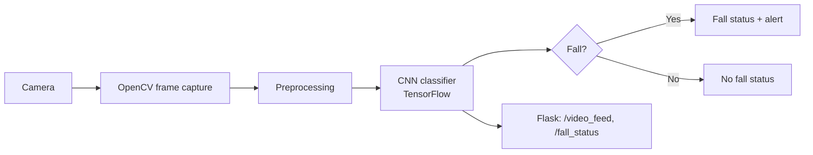

# Fall Detection for the Elderly using CNN

A computer-vision system that detects falls from a live camera feed using a CNN, served through a small Flask web app.


## Overview

Falls are a major safety risk for elderly people living alone or in care settings. This project classifies camera frames as **Fall** or **No Fall** with a convolutional neural network and shows the live feed and prediction in a browser.

The approach is related to my IEEE paper on lightweight CNN-based fall detection for hallway monitoring: [add paper title and DOI link].

## Features

- CNN-based Fall / No Fall classification with TensorFlow
- Real-time frame capture and inference with OpenCV
- Flask web interface with a live video stream and fall status
- Configurable alert recipient through a `.env` file

## How it works



The Flask app exposes three routes (from `main.py`):

| Route | Purpose |
|---|---|
| `/` | Web page (`index.html`, `style.css`) |
| `/video_feed` | Live MJPEG-style video stream |
| `/fall_status` | Plain-text fall status and model prediction |

## Tech stack

Python, TensorFlow, OpenCV, NumPy, SciPy, Matplotlib, Flask, python-dotenv.

## Repository structure

```
.
├── Fall/                # Fall class data/samples
├── No_Fall/             # No-fall class data/samples
├── models/              # Trained model
├── scripts/             # Detection and supporting scripts (real_time_detection.py)
├── index.html           # Web front end
├── style.css
├── main.py              # Flask app entry point
└── requirements.txt
```

## Getting started

**Prerequisites:** Python 3.11.4 or lower (TensorFlow does not support newer Python versions), and a webcam.

```bash
git clone https://github.com/joshPokala/Fall-detection-System-for-elderly-using-CNN.git
cd Fall-detection-System-for-elderly-using-CNN

python -m venv .venv
source .venv/bin/activate        # Windows: .venv\Scripts\activate
pip install -r requirements.txt
```

Create a `.env` file in the project root:

```
RECIPIENT_EMAIL=you@example.com
```

Run:

```bash
python main.py
```

Open <http://localhost:5000> to see the live feed.

## Results

> Add the metrics you can back up, for example accuracy, precision, recall and the test set used, taken from your notebook or your IEEE paper. Do not add numbers that are not reproducible from this repo.

## Limitations

- The web front end is still a work in progress.
- Performance depends on camera angle, lighting and the data the model was trained on.
- This is a research prototype and not a certified safety or medical system.

## Citation

If you use this work, please cite the associated paper: https://ieeexplore.ieee.org/document/11681696

## Suggested GitHub topics

`fall-detection` `computer-vision` `cnn` `tensorflow` `opencv` `flask` `deep-learning` `elderly-care` `python`
